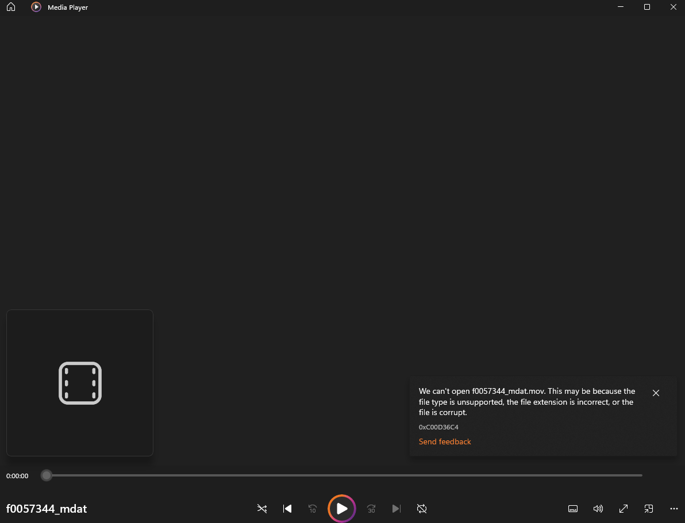
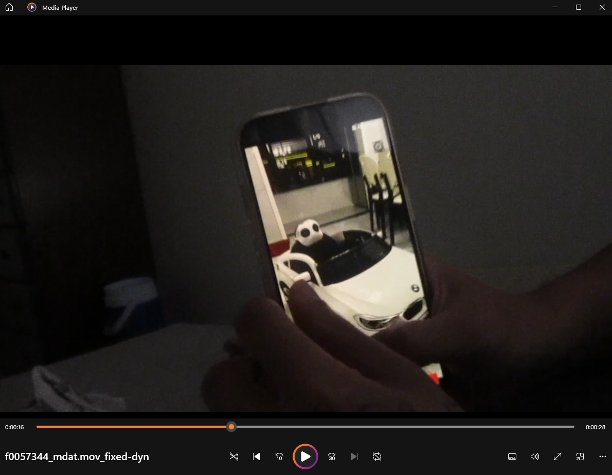
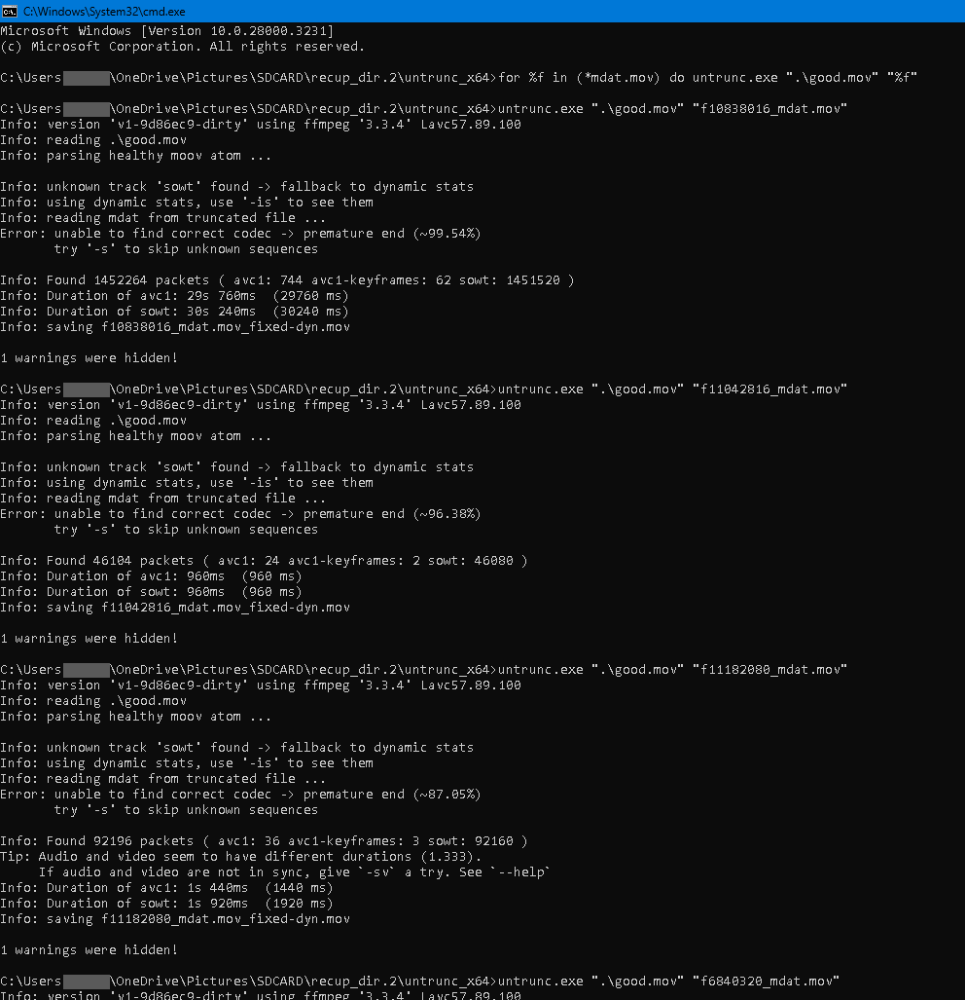

# SD Card Video Recovery: TestDisk + untrunc

Case study: recovering photos and videos from an SD card that Windows 11 wanted to format, then repairing the orphaned `.mov` fragments in bulk with a batch loop.

## Problem
An SD card from a Canon PowerShot ELPH 180 read fine on an iPhone and a MacBook. When plugged into a Windows 11 PC, it prompted to format the card because it couldn't be read. The files had to be saved first.

## What I did
1. **Recovered files with [TestDisk 7.2](https://www.cgsecurity.org/wiki/TestDisk)** before formatting anything. Total recovered: **3,714 files** (photos and videos).
2. **Photos** came back in good condition.
3. **Videos** came back as fragments (`ftyp` / `mdat` pieces) with no valid `moov` index, so players refused to open them.
4. Formatted the card only after confirming the recovery was complete.
5. **Repaired the videos with [untrunc](https://github.com/ponchio/untrunc)**, using a healthy reference clip (`good.mov`) from the same camera and settings. The untrunc GUI handles one file at a time, so I used a command-prompt loop to process them all.

## Batch repair
Put `untrunc.exe`, the reference clip renamed to `good.mov`, and the recovered `*_mdat.mov` files in one folder, then run [`recover_all.bat`](recover_all.bat):

```bat
for %%f in (*_mdat.mov) do (
  untrunc.exe ".\good.mov" "%%f"
)
```

Interactive one-liner equivalent:

```bat
for %f in (*mdat.mov) do untrunc.exe ".\good.mov" "%f"
```

Each repaired file is saved next to the original as `<name>_mdat.mov_fixed-dyn.mov`.

## Results

**Before:** Windows Media Player refuses the recovered fragment.



**After:** the same file, repaired by untrunc, plays back (28 s clip).



**untrunc batch output:**



### Limitations
Results were not uniform. Some files ended with `premature end` (for example ~87% and ~96% of the data reached), and a few repaired clips were only 1 to 2 seconds long. Repaired = playable video recovered from fragments, not necessarily the full original footage.

## Lessons learned
- Stop using a card as soon as it misbehaves; every write can overwrite recoverable data.
- Recover to a **different drive**, and only format after verifying the recovery.
- The reference file must come from the **same camera and settings**, or untrunc can't rebuild the index correctly.
- Recovered files may lose their names and order; expect to sort them afterwards.

## Environment
- Windows 11
- Camera: Canon PowerShot ELPH 180
- TestDisk 7.2 (CGSecurity)
- untrunc `v1-9d86ec9-dirty`, ffmpeg 3.3.4 (Windows build)

## Credits
- [TestDisk / PhotoRec](https://www.cgsecurity.org/) by Christophe Grenier (CGSecurity)
- [untrunc](https://github.com/ponchio/untrunc) by Federico Ponchio

This repo contains only documentation and a helper script. No personal media or third-party binaries are included.

## License
MIT. See [LICENSE](LICENSE).
